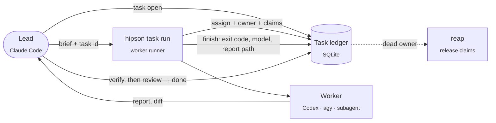

<div align="center">

# Hipson

**One lead agent. Many workers. One ledger of who did what, with evidence.**

[](https://github.com/Hipson47/Hipson/actions/workflows/ci.yml)


[](https://github.com/Hipson47/Hipson/blob/main/LICENSE)

[Why](#why-it-exists) · [Built with itself](#built-with-itself) · [How it works](#how-it-works) · [Quick start](#quick-start) · [MCP](#use-it-from-a-lead-agent-mcp) · [Docs](https://github.com/Hipson47/Hipson/blob/main/docs/README.md)

</div>

## Lead quick reference

- After context loss: `hipson lead resume`
- What needs attention now: `hipson task now`
- Acknowledge deliveries: `hipson task ack --assignment A-0001`
- Verify the candidate: `hipson task verify --task T-0001 -- COMMAND [ARGS...]`
- Run workers: `hipson task run --task T-0001 --actor codex --role builder --mode rw --scope src -- COMMAND [ARGS...]`

<table>
<tr>
<td width="44%" align="center">

</td>
<td width="56%">

**A control plane for the coordination layer, not another agent.**

A lead (for example Claude Code) opens tasks and hands bounded pieces to workers: Codex, Antigravity,
subagents. Every task, assignment, path claim and result lands in one transactional SQLite ledger on your
machine, next to a hash-chained evidence log linked by task id.

- **No silent overlap:** a second writer on the same paths is refused before it starts (`exit 75`).
- **No zombie locks:** a dead run's claims are reaped automatically.
- **Evidence, not confidence:** worker results are process results; only the lead says `done`.
- **Local-first:** no cloud service, zero runtime dependencies, Apache-2.0.

<sub>The film on the left was produced by an agent pipeline (Claude directing and animating, Codex reviewing
frames and running QA) from facts in this repository only. Silent excerpt, 28 s.</sub>

</td>
</tr>
</table>

<div align="center">


<sub>Rendered from the real `hipson task events --json` record of building Hipson's own evidence hardening (task T-0003; long summaries shortened): builder → independent reviewer → builder with fixes → lead verification → done.</sub>

</div>

---

## Why it exists

Agents drift when each one keeps its own notes, its own plan and its own idea of "done". Two writers edit the
same files. A crashed run keeps a lock forever. A worker's "all tests pass" gets taken as proof.

Hipson fixes the coordination layer, not the agents:

- **One source of truth per task.** Status, assignments, path claims and an append-only event log in one SQLite store.
- **No silent overlap.** A writer must claim its paths; an overlapping live claim is refused before the worker starts.
- **No zombie locks.** Runs launched through the wrapper record their owner (process group, boot id, host); when
  that owner is gone, its claims are reaped. Assignments recorded by hand can carry a lease instead.
- **Evidence, not confidence.** Worker results are recorded as process results; only the lead moves a task to `done`.
- **Workers stay workers.** Agents launched by a lead switch to *worker mode*: no own orchestration, no own notes, no commits.

## Built with itself

The task ledger in this repository was built by Claude Code as lead with Codex as builder and reviewer and
Antigravity as a second reviewer; once the ledger existed, the rest of the work ran through it. Numbers from
branch `feat/task-ledger`, 2026-10-25:

| What | Result |
|---|---|
| Work recorded in the ledger | 7 tasks, 11 worker assignments (5 builder, 4 reviewer, 2 explorer), 48 events |
| Independent review rounds | Each code slice reviewed by a fresh read-only Codex run before commit (15 findings); a final whole-branch review by Codex and Antigravity (12 findings, 9 fixed, 3 judged non-issues); one more concurrency bug found by a stress test and fixed with a regression test |
| Test suite | 675 tests, 0 skipped on Linux CI (strict skip allowlist on macOS and Windows CI), run by both `pytest` and the dependency-free `scripts/run_tests.py` (1.5.0, 2026-10-27; 404 tests when the ledger landed) |
| Mutation gate | 65.12%: 1,331 / 2,044 mutants killed across four modules (1.2.0); the committed baseline (60.82% minimum, at most 727 survivors, 0 without tests, 0 timeouts) fails CI on regression |
| Agent e2e | Nine offline missions include false completion, altered tests and stale verification, with reference and broken solutions. Published live Codex baseline (gpt-6.1-sol): 3/3 original missions; new live measurements are lead-run. [docs/AGENT_E2E.md](https://github.com/Hipson47/Hipson/blob/main/docs/AGENT_E2E.md) |
| Static gates | `ruff`, `mypy`, `bandit`, `pip-audit`, `compileall`, wheel build (CI on Python 3.11 and 3.12) |
| Runtime dependencies | none (`dependencies = []`) |

Failure cases that are covered by tests, not just described: two processes racing for the same claim, a worker
whose runner is `SIGKILL`ed while the worker survives (claims stay), a dead process group (claims released),
a worker that ignores `SIGTERM` and its leftover child processes, readers racing writers, twelve concurrent
evidence writers keeping one hash chain, and secrets nested
inside evidence payloads.

## How it works



| Who | Does |
|---|---|
| **Lead** | Plans, opens the task, briefs workers, verifies results itself, closes the task. The only one that sets `done`. |
| **Runner** (`hipson task run`) | Records the assignment with owner and claims, contains the worker tree in a POSIX process group or Windows Job Object, forwards signals, records the result. |
| **Worker** | Does the bounded job in worker mode and returns evidence. Never writes the ledger, never talks to other workers. |
| **Hipson** | Ledger, claims, reaping, evidence chain, MCP tools, and the existing local workflow (scan, packets, verify, audit). |

## Quick start

Requires Git and Python 3.11+; [uv](https://docs.astral.sh/uv/getting-started/installation/)
can install Python for you. Install for your OS, then run `hipson init` from your project.

| OS | Support |
|---|---|
| Linux | Full CLI, ledger, MCP, evidence and native worker runner |
| macOS | Full CLI, ledger, MCP, evidence and native worker runner |
| Windows native | Full CLI, ledger, MCP, evidence and native worker runner |
| Windows WSL2 | Full Linux support |

### Linux

```bash
curl -LsSf https://astral.sh/uv/install.sh | sh
export PATH="$HOME/.local/bin:$PATH"
uv tool install --python 3.12 git+https://github.com/Hipson47/Hipson
uv tool update-shell
cd /path/to/your/project
hipson init
```

### macOS

Install Git first (`xcode-select --install` if missing). In Terminal:

```bash
curl -LsSf https://astral.sh/uv/install.sh | sh
export PATH="$HOME/.local/bin:$PATH"
uv tool install --python 3.12 git+https://github.com/Hipson47/Hipson
uv tool update-shell
cd /path/to/your/project
hipson init
```

The native runner uses Python for process containment; no Bash or GNU utilities are required.

### Windows native (PowerShell)

Install Git for Windows, then install uv:

```powershell
powershell -ExecutionPolicy ByPass -c "irm https://astral.sh/uv/install.ps1 | iex"
```

Reopen PowerShell, then:

```powershell
uv tool install --python 3.12 git+https://github.com/Hipson47/Hipson
uv tool update-shell
$env:Path = "$(uv tool dir --bin);$env:Path"
Set-Location C:\path\to\your\project
hipson init
```

Run workers directly with `hipson task run` (example below). It records the assignment and
process outcome, forwards console interrupts and contains descendants in a Windows Job Object.
The Bash example and Linux agent e2e harness still require WSL2.

### Windows WSL2

In an administrator PowerShell, install Ubuntu with `wsl --install -d Ubuntu` and restart if prompted.
Open Ubuntu and follow the **Linux** commands above. Keep projects in `~/code`, with the lead client,
Hipson and workers in that same WSL distro.

`hipson init` checks prerequisites, creates or migrates the ledger, registers MCP with Claude Code
and/or Codex found on PATH, and verifies MCP with an initialize/tools-list handshake. It shows the
plan and asks before making changes. Use `--dry-run` to preview, `--yes` for unattended setup,
`--client claude|codex` to select a client, or `--client none` for the ledger only.
Claude defaults to project scope (`.mcp.json`); `--scope user` selects its user config. Codex uses
`$CODEX_HOME/config.toml` (default `~/.codex/config.toml`). Existing registrations are left alone;
config edits get unique backups first. Restart the lead client after setup, then open your first task below.

### Run from a clone instead

On any OS, after installing uv and Git:

```text
git clone https://github.com/Hipson47/Hipson.git
cd Hipson
uv sync --python 3.12 --no-dev
uv run --no-dev hipson init --project /path/to/your/project
```

Use `uv run --no-dev hipson` in place of `hipson` below. For the wrapper, virtualenv activation,
MCP registration from a clone, PATH troubleshooting and verification commands, see
[docs/INSTALL.md](https://github.com/Hipson47/Hipson/blob/main/docs/INSTALL.md).

Run a task (the same command syntax works in PowerShell):

Use the task id printed by `task open` in place of `T-0001` when your ledger already has tasks.

```bash
hipson task open --project . --title "Fix parser" --objective "Parser accepts trailing commas" --acceptance "tests pass"
hipson task run --task T-0001 --actor codex --role builder --mode rw --scope src/parser -- python -c "print('worker check')"
hipson task now
hipson task ack --assignment A-0001 --note "Read worker outcome and independently checked the change"
hipson task verify --task T-0001 -- git diff --check
hipson task status --task T-0001 --to review --actor lead --summary "Lead verification passed"
hipson task status --task T-0001 --to done --actor lead
hipson task events --task T-0001
```

Use `hipson task now --project .` for pending results, activity ages, blockers, review decisions
and cleanup. After context loss, `hipson lead resume --project .` restores objectives, acceptance,
decisions, failed attempts, findings, verification freshness and Git state in bounded text.
Both use sidecar-free ledger snapshots and refuse stores with a nonempty WAL or rollback journal until the
writable owner checkpoints/closes the store. Git dirty state uses index/stat observations; tracked
content and submodule contents are not inspected. Add `--json` for the full view. Use the assignment id printed by your runner
in place of `A-0001` when acknowledging its result.

Wrap real workers so the ledger fills itself:

```bash
TASK=$(hipson task open --project . --title "Add rate limit" --objective "API returns 429 over quota" --json \
  | python3 -c 'import json,sys; print(json.load(sys.stdin)["id"])')
hipson task run --task "$TASK" --actor codex --role builder --mode rw --scope src/api --rollout codex \
  -- codex exec -s workspace-write < brief.md
hipson task events --task "$TASK"
```

The runner exits with the worker's code, **75** for an assignment refusal, **76** for a project
mismatch, or **64** for invalid arguments. Use `--result-file PATH` to ingest a structured worker
report. The process outcome is recorded even if the report is rejected.

The ledger lives at `$HIPSON_LEDGER` or `~/.config/hipson/ledger.sqlite`
(`$env:USERPROFILE\.config\hipson\ledger.sqlite` on native Windows).
`HIPSON_HOME` and `XDG_CONFIG_HOME` can change its config directory. Details, recovery rules and limits:
[docs/TASK_LEDGER.md](https://github.com/Hipson47/Hipson/blob/main/docs/TASK_LEDGER.md).

## Use it from a lead agent (MCP)

Hipson ships a stdio MCP server. Read tools: `task.show`, `task.brief`, `task.context`, `task.events`,
`task.list`, `task.board`, `task.findings`.
Write tools (each requires `approved=true`): `task.open`, `task.assign`, `task.finish`, `task.event`,
`task.status`, `task.reap`, `task.finding_add`, `task.finding_update`.

```bash
hipson init --client claude
# Or: hipson init --client codex
```

The server only uses the configured ledger, never a caller-supplied database path, and read tools never create
or migrate the store.

## More than the ledger

The ledger sits on top of Hipson's existing local workflow layer:

| Area | Commands |
|---|---|
| Work planning | `hipson work`, `hipson route`, `hipson contract show` |
| Bounded packets for agents | `hipson packet review / exec`, `hipson packet preflight` |
| Revision-bound task verification | `hipson task verify --task T -- COMMAND [ARGS...]` |
| Local verification and evidence | `hipson verify run`, `hipson evidence append / show / verify`, `hipson audit show` |
| Run bundles and release gates | `hipson kit review`, `hipson autopilot`, `hipson run status / validate / handoff`, `hipson release claim` |
| Memory and sessions | `hipson memory`, `hipson session`, `hipson learn` (approval-gated) |
| Agent integration | `hipson install agents`, `hipson agent bootstrap`, `hipson mcp serve` |
| Optional AI second opinions | `hipson sidecar route / run`, `hipson quality report / eval` (explicit, advisory) |

Full command reference and workflows: [docs/USAGE.md](https://github.com/Hipson47/Hipson/blob/main/docs/USAGE.md). All docs: [docs/README.md](https://github.com/Hipson47/Hipson/blob/main/docs/README.md).

## Safety in short

- **Provider-free by default.** Core commands make no network calls; provider sidecars are explicit and advisory.
- **Repository content is data, not instructions.** Packets are bounded; sensitive files are skipped or summarized.
- **Redaction before persistence.** Evidence, work plans and release claims are redacted recursively, including
  any value under a credential-named key. Ledger text and MCP error messages get pattern-based redaction.
- **Write gates.** Every MCP write needs `approved=true`; invalid arguments are rejected before a database is opened.
- **Honest limits.** Actor names are recorded labels, not authenticated identities. Path claims coordinate
  cooperating agents; they are not filesystem permissions. Worker mode is an instruction, not a sandbox.

Hipson is a **beta coordination tool for cooperating agents**, not a security boundary or an enforced
release gate. A task reaching `done` checks ledger closure, not the truth of its evidence or release readiness.

Keep real provider keys in `~/.config/hipson/agents.env` or your shell, never in git.

## Development

```bash
uv sync --all-extras
uv run ruff check .
uv run mypy src/hipson
uv run bandit -q -r src -c pyproject.toml
uv run python scripts/run_tests.py
uv run python -m pytest -q
uv build
```

CI runs Linux on Python 3.11/3.12 and macOS/Windows on Python 3.12, including installed CLI ledger
commands and MCP initialize/tools-list over stdio. Mutation testing and `pip-audit` run on Linux.
On Linux with `CI` set, both test runners fail on any skip, including pytest collection skips.
The standalone runner reports passed, skipped and failed counts separately. Outside CI,
missing prerequisites produce explicit skips, including the pytest-policy probe when pytest is unavailable.
Wrapper tests resolve the installed CLI
through `HIPSON_BIN`, then `PATH`, then the checkout's `.venv/bin/hipson`
(`.venv\Scripts\hipson.exe` on Windows); missing prerequisites fail Linux CI.
The agent e2e harness stays Linux/WSL2-only; other platforms report explicit skips.
Artifact tests validate every keyword currently used in `schemas/`, including nested array items,
additional properties, references, nullable types, patterns and bounds. Unsupported schema keywords
fail even in unused branches.

Python 3.12 CI also enforces a bounded mutation baseline within a 20-minute step:

```bash
uv run mutmut run --max-children 2
uv run mutmut export-cicd-stats
uv run python scripts/mutation_gate.py
```

The fresh Linux baseline took 443.31 seconds (7m 23s) with Python 3.12.3 and mutmut 3.8.0 on 2026-10-25.

The mutated paths are `approvals.py`, `evidence.py`, `redaction.py` and `sandbox.py`; the test selection,
including `tests/test_evidence.py`, is in `pyproject.toml`. The score is **killed / total**, counting only
test-killed mutants as kills. The gate enforces the committed minimum score and population and caps
survivors, mutants without tests and timeouts. It rejects missing, malformed or incomplete results,
skipped mutants, suspicious outcomes, interruptions and segfaults.

To update `[tool.hipson.mutation-gate]` in `pyproject.toml`, start from a fresh checkout or move `mutants/`
aside, run the three commands above with the recorded mutmut/Python versions, inspect `uv run mutmut results`,
and review changed survivors before editing the baseline counts, minimum score (rounded down to two decimals), date,
versions and elapsed time. Baseline updates require a reviewed diff; the gate never learns a new threshold automatically.
Changes are listed in [CHANGELOG.md](https://github.com/Hipson47/Hipson/blob/main/CHANGELOG.md).

## Project layout

```text
src/hipson/      CLI, ledger, evidence, MCP server, runtime, packaged assets
schemas/         JSON schemas for every artifact kind
tests/           pytest suite (also runnable without pytest)
examples/        agent-run.sh worker wrapper
skills/          Hipson's own agent skills; third-party skills are fetched on demand into skills/external/
docs/            live documentation; docs/archive/ holds historical plans and audits
```

## License

Apache License 2.0. See [LICENSE](https://github.com/Hipson47/Hipson/blob/main/LICENSE).
