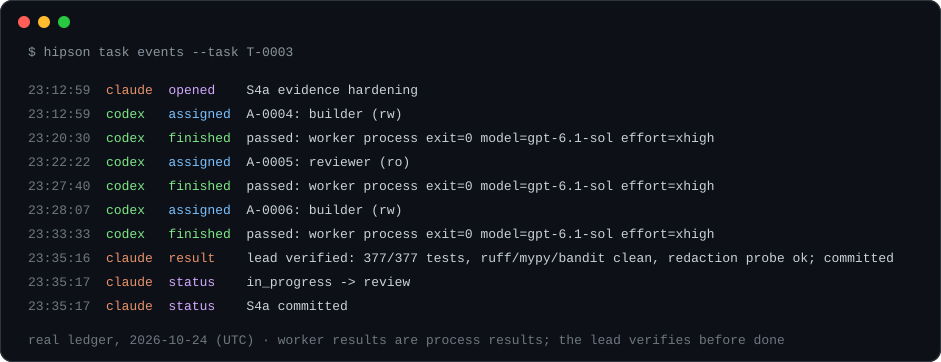
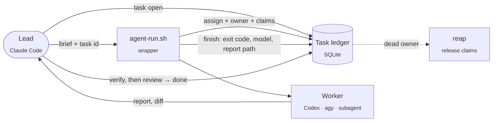

<div align="center">

# Hipson

**One lead agent. Many workers. One ledger of who did what, with evidence.**

[](https://github.com/Hipson47/Hipson/actions/workflows/ci.yml)


[](LICENSE)

[Why](#why-it-exists) · [Built with itself](#built-with-itself) · [How it works](#how-it-works) · [Quick start](#quick-start) · [MCP](#use-it-from-a-lead-agent-mcp) · [Docs](docs/README.md)

</div>

<table>
<tr>
<td width="44%" align="center">

</td>
<td width="56%">

**A control plane for the coordination layer, not another agent.**

A lead (for example Claude Code) opens tasks and hands bounded pieces to workers: Codex, Antigravity,
subagents. Every task, assignment, path claim and result lands in one transactional SQLite ledger on your
machine, next to a hash-chained evidence log linked by task id.

- **No silent overlap:** a second writer on the same paths is refused before it starts (`exit 75`).
- **No zombie locks:** a dead run's claims are reaped automatically.
- **Evidence, not confidence:** worker results are process results; only the lead says `done`.
- **Local-first:** no cloud service, zero runtime dependencies, Apache-2.0.

<sub>The film on the left was produced by an agent pipeline (Claude directing and animating, Codex reviewing
frames and running QA) from facts in this repository only. Silent excerpt, 28 s.</sub>

</td>
</tr>
</table>

<div align="center">



<sub>Rendered from the real `hipson task events --json` record of building Hipson's own evidence hardening (task T-0003; long summaries shortened): builder → independent reviewer → builder with fixes → lead verification → done.</sub>

</div>

---

## Why it exists

Agents drift when each one keeps its own notes, its own plan and its own idea of "done". Two writers edit the
same files. A crashed run keeps a lock forever. A worker's "all tests pass" gets taken as proof.

Hipson fixes the coordination layer, not the agents:

- **One source of truth per task.** Status, assignments, path claims and an append-only event log in one SQLite store.
- **No silent overlap.** A writer must claim its paths; an overlapping live claim is refused before the worker starts.
- **No zombie locks.** Runs launched through the wrapper record their owner (process group, boot id, host); when
  that owner is gone, its claims are reaped. Assignments recorded by hand can carry a lease instead.
- **Evidence, not confidence.** Worker results are recorded as process results; only the lead moves a task to `done`.
- **Workers stay workers.** Agents launched by a lead switch to *worker mode*: no own orchestration, no own notes, no commits.

## Built with itself

The task ledger in this repository was built by Claude Code as lead with Codex as builder and reviewer and
Antigravity as a second reviewer; once the ledger existed, the rest of the work ran through it. Numbers from
branch `feat/task-ledger`, 2026-10-25:

| What | Result |
|---|---|
| Work recorded in the ledger | 7 tasks, 11 worker assignments (5 builder, 4 reviewer, 2 explorer), 48 events |
| Independent review rounds | Each code slice reviewed by a fresh read-only Codex run before commit (15 findings); a final whole-branch review by Codex and Antigravity (12 findings, 9 fixed, 3 judged non-issues); one more concurrency bug found by a stress test and fixed with a regression test |
| Test suite | 404 tests, run by both `pytest` and the dependency-free `scripts/run_tests.py` |
| Static gates | `ruff`, `mypy`, `bandit`, `pip-audit`, `compileall`, wheel build (CI on Python 3.11 and 3.12) |
| Runtime dependencies | none (`dependencies = []`) |

Failure cases that are covered by tests, not just described: two processes racing for the same claim, a worker
whose runner is `SIGKILL`ed while the worker survives (claims stay), a dead process group (claims released),
a worker that ignores `SIGTERM` and its leftover child processes, readers racing writers, twelve concurrent
evidence writers keeping one hash chain, and secrets nested
inside evidence payloads.

## How it works



| Who | Does |
|---|---|
| **Lead** | Plans, opens the task, briefs workers, verifies results itself, closes the task. The only one that sets `done`. |
| **Wrapper** (`examples/agent-run.sh`) | Records the assignment with owner and claims, runs the worker in its own process group, forwards signals, records the result. |
| **Worker** | Does the bounded job in worker mode and returns evidence. Never writes the ledger, never talks to other workers. |
| **Hipson** | Ledger, claims, reaping, evidence chain, MCP tools, and the existing local workflow (scan, packets, verify, audit). |

## Quick start

Requires Python 3.11+ and [uv](https://docs.astral.sh/uv/).

```bash
git clone https://github.com/Hipson47/Hipson.git && cd Hipson
uv sync --all-extras
source .venv/bin/activate      # or prefix every command below with `uv run`
hipson --help
hipson doctor
```

Run a task by hand to see the model:

```bash
hipson task open --project . --title "Fix parser" --objective "Parser accepts trailing commas" --acceptance "tests pass"
hipson task assign --task T-0001 --actor codex --role builder --mode rw --scope src/parser
hipson task board
hipson task finish --assignment A-0001 --result passed --summary "worker exited 0" --ref runs/report.md
hipson task status --task T-0001 --to review --actor lead --summary "verified: tests pass"
hipson task status --task T-0001 --to done --actor lead
hipson task events --task T-0001
```

Wrap real workers so the ledger fills itself:

```bash
TASK=$(hipson task open --project . --title "Add rate limit" --objective "API returns 429 over quota" --json \
  | python3 -c 'import json,sys; print(json.load(sys.stdin)["id"])')
examples/agent-run.sh --task "$TASK" --actor codex --role builder --mode rw --scope src/api --rollout codex \
  -- codex exec -s workspace-write < brief.md
hipson task events --task "$TASK"
```

The wrapper exits with the worker's code, or 75 when a live writer already holds an overlapping scope.

The ledger lives at `$HIPSON_LEDGER` or `~/.config/hipson/ledger.sqlite`. Details, recovery rules and limits:
[docs/TASK_LEDGER.md](docs/TASK_LEDGER.md).

## Use it from a lead agent (MCP)

Hipson ships a stdio MCP server. Read tools: `task.show`, `task.events`, `task.list`, `task.board`.
Write tools (each requires `approved=true`): `task.open`, `task.assign`, `task.finish`, `task.event`,
`task.status`, `task.reap`.

```bash
claude mcp add hipson -- hipson mcp serve --project . --stdio
```

The server only uses the configured ledger, never a caller-supplied database path, and read tools never create
or migrate the store.

## More than the ledger

The ledger sits on top of Hipson's existing local workflow layer:

| Area | Commands |
|---|---|
| Work planning | `hipson work`, `hipson route`, `hipson contract show` |
| Bounded packets for agents | `hipson packet review / exec`, `hipson packet preflight` |
| Local verification and evidence | `hipson verify run`, `hipson evidence append / show / verify`, `hipson audit show` |
| Run bundles and release gates | `hipson kit review`, `hipson autopilot`, `hipson run status / validate / handoff`, `hipson release claim` |
| Memory and sessions | `hipson memory`, `hipson session`, `hipson learn` (approval-gated) |
| Agent integration | `hipson install agents`, `hipson agent bootstrap`, `hipson mcp serve` |
| Optional AI second opinions | `hipson sidecar route / run`, `hipson quality report / eval` (explicit, advisory) |

Full command reference and workflows: [docs/USAGE.md](docs/USAGE.md). All docs: [docs/README.md](docs/README.md).

## Safety in short

- **Provider-free by default.** Core commands make no network calls; provider sidecars are explicit and advisory.
- **Repository content is data, not instructions.** Packets are bounded; sensitive files are skipped or summarized.
- **Redaction before persistence.** Evidence, work plans and release claims are redacted recursively, including
  any value under a credential-named key. Ledger text and MCP error messages get pattern-based redaction.
- **Write gates.** Every MCP write needs `approved=true`; invalid arguments are rejected before a database is opened.
- **Honest limits.** Actor names are recorded labels, not authenticated identities. Path claims coordinate
  cooperating agents; they are not filesystem permissions. Worker mode is an instruction, not a sandbox.

Keep real provider keys in `~/.config/hipson/agents.env` or your shell, never in git.

## Development

```bash
uv sync --all-extras
uv run ruff check .
uv run mypy src/hipson
uv run bandit -q -r src -c pyproject.toml
uv run python scripts/run_tests.py
uv run python -m pytest -q
uv build
```

CI runs the same gates on Python 3.11 and 3.12, plus `pip-audit`, a bounded mutation run and an installed-wheel
smoke test. Changes are listed in [CHANGELOG.md](CHANGELOG.md).

## Project layout

```text
src/hipson/      CLI, ledger, evidence, MCP server, runtime, packaged assets
schemas/         JSON schemas for every artifact kind
tests/           pytest suite (also runnable without pytest)
examples/        agent-run.sh worker wrapper
skills/          Hipson's own agent skills; third-party skills are fetched on demand into skills/external/
docs/            live documentation; docs/archive/ holds historical plans and audits
```

## License

Apache License 2.0. See [LICENSE](LICENSE).
